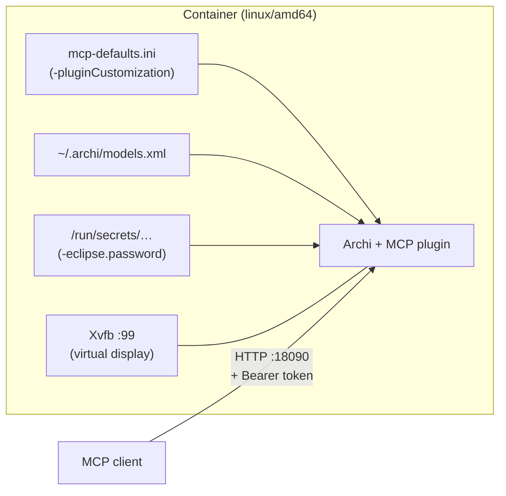

# Running Archi and the MCP server headless

Archi is a desktop application, but it runs unattended on a server or in a container under a virtual display (Xvfb), and the plugin needs no changes to run that way. This page gives a working container recipe, explains how the server starts and which model it serves with nobody at the screen, and warns about the one trap with authentication.

**What was tested:** Archi 5.10.0 for Linux with plugin 1.10.0, in a `linux/amd64` Debian container on an Apple-silicon Mac (so under emulation; start times and memory will be better on a real x86_64 host). The bearer-token trap described below was found and tested with plugin 1.9.0; the code involved is unchanged in 1.10.0. Everything not tested is listed at the end.



## How each piece works

### The server starts by itself

The server starts with Archi only when **auto-start** is on. Set it, with the bind address and token auth, in a customization file passed with Eclipse's `-pluginCustomization` option (see *Presetting defaults for many machines* in the [README](../README.md#presetting-defaults-for-many-machines)):

```properties
net.vheerden.archi.mcp/mcp.server.autoStart=true
net.vheerden.archi.mcp/mcp.server.bindAddress=0.0.0.0
net.vheerden.archi.mcp/mcp.server.authTokenEnabled=true
```

Add `net.vheerden.archi.mcp/mcp.server.readOnly=true` when the server only answers questions (see *Approval mode with nobody at the screen* below).

> **Plugin 1.9.0 ignores `-pluginCustomization`.** On 1.9.0 write the same three keys, without the `net.vheerden.archi.mcp/` prefix and after an `eclipse.preferences.version=1` line, to `~/.archi/.metadata/.plugins/org.eclipse.core.runtime/.settings/net.vheerden.archi.mcp.prefs` before the first launch.

The workbench starts normally on the virtual display with no blocking dialog. In the tested run the server was listening about a minute after the container started.

### A model is open at startup

The server serves the models Archi has open, so Archi must open one by itself. Archi reopens every model listed in `~/.archi/models.xml`, and a hand-written file works:

```xml
<?xml version="1.0" encoding="UTF-8"?>
<models>
  <model file="/models/model.archimate"/>
</models>
```

List several models to serve several; clients then pass `modelId` (see `get-models`). Passing a `.archimate` path on Archi's command line works too, but only with a D-Bus session running in the container, because Archi on Linux receives the file over D-Bus. Without one, the path is silently ignored.

### Authentication without a desktop keyring

To reach the server from outside the container, it must bind to `0.0.0.0`, and binding beyond loopback switches off the plugin's Host/Origin check. **Turn token auth on.** With auth on and no token generated yet, the server refuses every request with `401`, which is the safe default.

> [!WARNING]
> **The secure-storage trap.** On Linux without a desktop keyring (every container), the bearer token is kept in Eclipse secure storage, protected by a master password. If the token is created the normal way, every later start stops at an invisible "enter secure storage password" dialog on the virtual display, and the MCP server never starts.
>
> - Launch Archi with `-eclipse.password <file>` **from the very first run**. It works only if the secure storage is *created* with the option in effect; adding it to existing storage still prompts.
> - Keep the option on every launch, and create the token after the first start. Restarts then come up with no prompt, and the token is enforced.
> - Mount the password file as a secret at run time. Never copy it into the image.

Creating the token still needs one pass through **Preferences → MCP Server → Authentication → Generate token**, and a new token takes effect after a restart. Running a VNC server against the Xvfb display for that one pass should work but has not been tested.

### Approval mode with nobody at the screen

Approval mode stays on by default, so nothing an agent proposes is applied until someone approves it in Archi's Pending Approvals view. In a headless Archi nobody can, so every change waits forever, while the tools that make changes are still listed to clients and an agent may still offer a change and tell its user to "approve it in Archi".

**For a deployment that only answers questions about a model, turn on read-only mode** in the customization file:

```properties
net.vheerden.archi.mcp/mcp.server.readOnly=true
```

A read-only server offers only the 20 tools that read the model (`get-model-info`, `get-views`, `get-view-contents`, `search-elements`, `export-view` and the rest). The tools that could change the model or write to the server's disk are not listed at all, so an agent never offers a change nobody can approve. `export-view` still returns the picture in the response, and refuses `inline: false`, so nothing is written to the container. The mode is read once each time the server starts.

An agent can tell it is talking to a read-only server in two ways: the `initialize` reply carries instructions that say so, and `get-model-info` reports `readOnly: true`. A client that calls a tool the server does not offer gets a JSON-RPC error (code `-32602`) with the message `Unknown tool: invalid_tool_name` and `Tool not found: <name>` in its `data`. It does not mention read-only mode, because the server has no such tool to answer for. The `nextSteps` in each successful response leave out any suggestion that names a tool the server does not offer. Tool descriptions, and other text in a response, can still name such tools; the instructions say so.

Without read-only mode, turning approval mode off (`mcp.server.approvalMode=false`) makes changes apply directly; do that only when every client holding the token is trusted to change the model.

### Images on a server other machines can reach

The container binds `0.0.0.0`, so the server counts as reachable from other machines, whatever the host publishes. On such a bind, a server that offers `add-image-to-model` (that is, one that is not read-only) takes an image only as `imageData`, sent by the caller. It refuses `filePath` and `url` with `INVALID_PARAMETER`, in the single form and in each entry of the `images` array, before it reads a file or fetches anything: otherwise any caller could make the server read a file it can see, or fetch a URL from the server's own network, such as a cloud metadata address. On the same bind, `export-view` returns the image in the response and refuses `inline: false` with `INVALID_PARAMETER`, so a caller cannot make the server write files to a directory of its choosing. To allow all three, set `net.vheerden.archi.mcp/mcp.server.allowServerImageSources=true`; the server reads it when it starts. An unusable value means refused. On a loopback bind the setting is not consulted, and `filePath`, `url` and file output work as before.

### Keeping the model current

The server serves the model Archi opened at startup and never reloads it. To serve a new version, replace the `.archimate` file and restart the container. That is the operator's process, and the plugin plays no part in it.

## The recipe

Set up a build folder:

```text
archi-headless/
  Dockerfile
  Archi/                                       extracted Archi-Linux64-5.10.0.tgz
  net.vheerden.archi.mcp_1.10.0.archiplugin    the release asset, not unzipped
  mcp-defaults.ini                             the customization file above
  model.archimate                              the model to serve
  storage_pw.txt                               secure-storage password, mounted at run time
```

1. Download `Archi-Linux64-5.10.0.tgz` from the [Archi releases](https://github.com/archimatetool/archi.io/releases) and extract it in the folder, leaving an `Archi/` subfolder next to the `Dockerfile`.
2. Download the plugin's `.archiplugin` from this project's [Releases](https://github.com/fanievh/archi-mcp-server/releases) page and put it in the folder as it is.
3. Save the customization file above as `mcp-defaults.ini`, and the model to serve as `model.archimate`.
4. Write the secure-storage password to `storage_pw.txt` with no trailing newline.
5. Save this as `Dockerfile` (no extension):

```dockerfile
# Archi + the Archi MCP Server plugin, unattended under Xvfb.
# Archi ships only an x86_64 Linux build: build and run this image as linux/amd64.
FROM debian:bookworm-slim

RUN apt-get update && apt-get install -y --no-install-recommends \
        xvfb libgtk-3-0 libxtst6 fonts-dejavu-core ca-certificates unzip \
    && rm -rf /var/lib/apt/lists/*

COPY Archi /opt/Archi

# Install the plugin as Archi's "Install Plugin" does: unpack it into the user dropins folder.
COPY net.vheerden.archi.mcp_1.10.0.archiplugin /tmp/plugin.zip
RUN mkdir -p /root/.archi/dropins \
    && unzip -q /tmp/plugin.zip -d /root/.archi/dropins \
    && rm -f /root/.archi/dropins/archi-plugin /tmp/plugin.zip

# Plugin defaults (auto-start, bind address, token auth), applied with -pluginCustomization.
COPY mcp-defaults.ini /etc/archi/mcp-defaults.ini

# The model(s) Archi reopens at startup. This route needs no D-Bus.
COPY model.archimate /models/model.archimate
RUN printf '%s\n' '<?xml version="1.0" encoding="UTF-8"?>' '<models>' \
                  '  <model file="/models/model.archimate"/>' '</models>' > /root/.archi/models.xml

ENV GDK_BACKEND=x11 GTK_OVERLAY_SCROLLING=0 DISPLAY=:99
EXPOSE 18090

# The secure-storage password comes from a file mounted at run time, never from the image.
CMD ["sh", "-c", "Xvfb :99 -screen 0 1600x1000x24 & exec /opt/Archi/Archi -pluginCustomization /etc/archi/mcp-defaults.ini -eclipse.password /run/secrets/archi_storage_password"]
```

Build and run it from the folder:

```bash
docker build --platform linux/amd64 -t archi-mcp .
docker run -d --name archi-mcp --platform linux/amd64 \
  -p 127.0.0.1:18090:18090 \
  -v "$PWD/storage_pw.txt:/run/secrets/archi_storage_password:ro" \
  archi-mcp
```

`-p 127.0.0.1:18090:18090` publishes the port to the host's loopback only. Drop the `127.0.0.1:` only if other machines must reach the server, and then put TLS and a firewall in front of it (see [SECURITY.md](../SECURITY.md)).

Check it from the host. Until a token exists, this answers `401`:

```bash
curl -s -o /dev/null -w '%{http_code}\n' -X POST http://127.0.0.1:18090/mcp \
  -H 'Content-Type: application/json' -H 'Accept: application/json, text/event-stream' \
  -H 'Authorization: Bearer <token>' \
  -d '{"jsonrpc":"2.0","id":1,"method":"initialize","params":{"protocolVersion":"2025-06-18","capabilities":{},"clientInfo":{"name":"check","version":"1"}}}'
```

Clients connect to `http://<host>:18090/mcp` as in the README, sending `Authorization: Bearer <token>`.

**Keep the container, keep the token.** The token lives in secure storage inside the container. `docker stop`, `docker start` and `docker restart` keep it; `docker rm` followed by a fresh `docker run` means generating it again.

**Measured in the tested run (emulated):** server listening about 58 s after the container started; image about 730 MB; about 515 MB of memory with a 330-element model open; all 74 tools listed.

## Other hosts

Only the Apple-silicon Mac run above was tested; treat the rest of this section as untested. The container is the same everywhere; only the host commands differ.

- **Linux, x86_64:** the best case, since Archi runs natively. The commands above work as they are; `--platform linux/amd64` is a no-op.
  - On SELinux hosts (Fedora, RHEL), mount the secret with `:ro,Z`. Otherwise Archi cannot read the password file, and you get the same silent hang as the secure-storage trap.
  - Docker's published ports bypass `ufw`, which is one more reason to publish to `127.0.0.1`.
- **Linux, ARM64, and macOS on Apple silicon:** keep `--platform linux/amd64` on both commands. On Linux, register amd64 emulation once with `docker run --privileged --rm tonistiigi/binfmt --install amd64`. Expect it to be slow.
- **Windows:** use Docker Desktop with the WSL2 backend and work from an Ubuntu shell inside WSL, with the files in the WSL filesystem rather than under `/mnt/c`; the Linux commands then work as they are. From PowerShell instead:
  - extract the Archi `.tgz` inside WSL, not onto NTFS, as the archive may contain symbolic links;
  - continue lines with a backtick, not a backslash;
  - write the password file without a trailing CRLF, which would silently become part of the password: `[IO.File]::WriteAllText("$PWD\storage_pw.txt", "your-password")`;
  - mount it with `-v "${PWD}\storage_pw.txt:/run/secrets/archi_storage_password:ro"`;
  - call `curl.exe`, not `curl`, which Windows PowerShell aliases to another command.

## Not tested

Linux and Windows hosts; native x86_64 timings; Archi versions other than 5.10.0; running as a non-root user; copying prepared secure storage between containers; TLS; generating the token over VNC; and MCP clients other than `curl` in front of the container.
