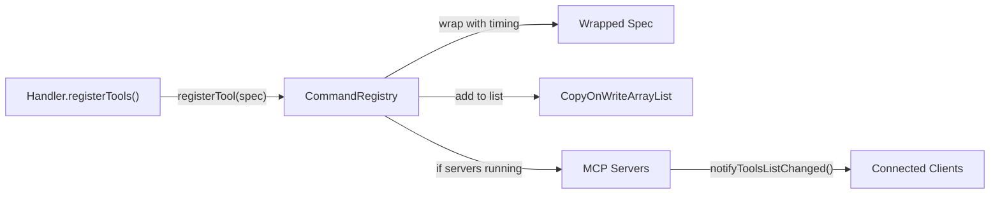
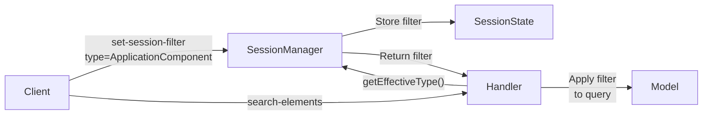
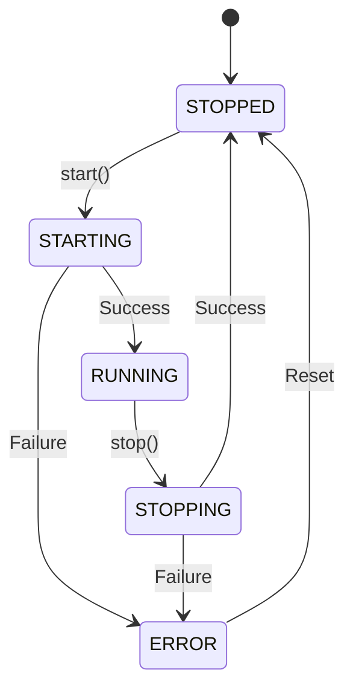

# MCP Protocol Integration

This document describes how the plugin integrates with the Model Context Protocol (MCP), including tool registration, response formatting, error handling, session management, resources, and transport configuration.

## Table of Contents

- [Tool Registration](#tool-registration)
- [Response Envelope](#response-envelope)
- [Error Responses](#error-responses)
- [Session Management](#session-management)
- [MCP Resources](#mcp-resources)
- [Transport Layer](#transport-layer)

## Tool Registration

The `CommandRegistry` is the central registry for all MCP tool definitions.

### Registration Flow



1. Each handler calls `registry.registerTool(spec)` during initialization
2. The registry wraps the spec with timing instrumentation (injects `durationMs` into `_meta`)
3. The spec is added to the thread-safe tool list
4. If MCP servers are already running, the tool is added to both Streamable-HTTP and SSE servers, and connected clients are notified

### Tool Specification Structure

Each tool defines:
- **Name** (kebab-case): `get-element`, `create-relationship`, `assess-layout`
- **Description**: product-quality documentation (purpose, parameters, related tools)
- **Input schema**: JSON Schema defining parameters with types and descriptions
- **Call handler**: `BiFunction<McpSyncServerExchange, CallToolRequest, CallToolResult>`
- **Annotations**: `readOnlyHint` and, for a tool that can change something, `destructiveHint` (see below)

### Read and Write Tools

Every tool is classified once, in `handlers/ToolAccess.java`, as **READ** (never changes the model or writes to the server's disk) or **WRITE** (can change either, or exists only to serve such a change, as the batch and approval tools do). There is no default: a tool missing from the table cannot be registered. The classification is applied at registration, in every mode, as MCP tool annotations:

- `readOnlyHint: true` on the 20 READ tools, `false` on the rest.
- `destructiveHint: true` on the WRITE tools that remove or destroy something (the `delete-*` tools, `remove-from-view`, `clear-view` and `merge-elements`), `false` on the other WRITE tools, and absent on a READ tool, where the hint has no meaning.

Some clients use these hints to decide whether to ask before running a tool.

**Read-only serving.** With the `mcp.server.readOnly` preference on (a checkbox on the MCP preference page, or a `-pluginCustomization` preset), the server registers only the READ tools. It reads the setting once each time it starts. On such a server:

- `tools/list` does not list a WRITE tool, and a call to one is answered by the SDK as an unknown tool (JSON-RPC `-32602`, `Tool not found: <name>` in `data`).
- The `initialize` reply carries `instructions` saying the server is read-only, and `get-model-info` reports `readOnly: true`.
- `nextSteps` leave out any suggestion that names a withheld tool. Tool descriptions and other response text can still name one; the instructions say so.
- `export-view` is READ because it only returns the picture; it refuses `inline: false`, so nothing is written to the server's disk.

[headless-deployment.md](headless-deployment.md) shows a read-only server in a container.

### Thread Safety

- `CopyOnWriteArrayList` for the tool spec list (safe reads from multiple Jetty threads)
- Volatile server references for cross-thread visibility
- Synchronized registration + notification for atomic tool addition

**Source:** `registry/CommandRegistry.java`

## Response Envelope

All tool responses use a consistent JSON envelope built by `ResponseFormatter`.

### Success Response

```json
{
  "result": {
    "id": "abc-123",
    "name": "Application Service",
    "type": "ApplicationService",
    "layer": "Application"
  },
  "nextSteps": [
    "Use get-relationships to explore connections",
    "Use search-elements to find related elements"
  ],
  "_meta": {
    "modelVersion": "42",
    "resultCount": 1,
    "isTruncated": false,
    "totalCount": 1,
    "sessionActive": true,
    "durationMs": 42,
    "model": { "id": "model-1", "name": "Bank", "resolution": "sole-model" }
  }
}
```

### Which keys each envelope carries

`ResponseFormatter` has one method per envelope shape, and every key below is written only where the table says. The registry then adds `durationMs` (and `model`, when the call acted on one) to every tool response, errors included.

| Key | Success (`formatSuccess`) | Graph (`formatGraph`) | Summary (`formatSummary`) | Error (`formatError`) | Error with extras (`formatErrorWithExtras`) | Dry run (`formatDryRun`) |
|-----|---------|-------|---------|-------|------------------|---------|
| top-level body | `result` | `graph` (`nodes`, `edges`) | `summary` (a string) | `error` | `error`, with the extra fields merged in | `dryRun` |
| `nextSteps` | when the tool gives any | when the tool gives any | when the tool gives any | never | when the tool gives any | when the tool gives any |
| `_meta.modelVersion` | yes | yes | yes | — | yes | yes |
| `_meta.resultCount` | yes | yes (the node count) | yes | — | — | — |
| `_meta.edgeCount` | — | yes | — | — | — | — |
| `_meta.totalCount` | yes | yes | yes | — | — | — |
| `_meta.isTruncated` | yes | yes | always `false` | — | — | — |
| `_meta.dryRun` | — | — | — | — | — | always `true` |
| `_meta.sessionActive` | yes | yes | yes | yes | yes | yes |
| `_meta.durationMs` | yes | yes | yes | yes | yes | yes |
| `_meta.model` | when the call acted on a model | same | same | same | same | same |

| Key | Meaning |
|-----|---------|
| `nextSteps` | Suggested next actions for the agent. Omitted, not empty, when the tool gives none. On a read-only server, entries naming a tool the server does not offer are dropped from a success response, which can leave an empty array |
| `_meta.modelVersion` | The model's mutation counter as a decimal string (`"42"`); compare it as an integer (see below) |
| `_meta.resultCount` / `totalCount` / `isTruncated` | Items in this response, items available, and whether the response holds fewer than are available |
| `_meta.edgeCount` | Edges in a graph response |
| `_meta.dryRun` | Marks a cost estimate, which carries no result |
| `_meta.sessionActive` | Always `true`. It carries no information and is kept so existing clients do not break |
| `_meta.durationMs` | Time the call took, in milliseconds |
| `_meta.model` | The model the call acted on: `id`, `name` and `resolution` (`addressed`, `session-default` or `sole-model`). Present on every call that acted on a model, in immediate, batched and proposal modes alike |

Handlers add these to the `_meta` of the envelope they built, when they apply:

| Key | Set when |
|-----|----------|
| `_meta.modelChanged` | The model changed since this session's last query (`addModelChangedFlag`) |
| `_meta.cursor` | More pages are available; pass it back to get the next one (`addCursorToken`) |
| `_meta.cacheHit` | The response was served from the session cache (`addCacheHitFlag`) |
| `_meta.sessionWarning` | The session is approaching an unhealthy state, such as a high error count (`addSessionWarning`) |
| `_meta.warning` | A query tool did not use what was asked for, such as an unknown `fields` preset it replaced with the default |
| `_meta.notFound` | `get-element` was given several ids and some name no element; it lists them |

### Render Staleness Stamp (`export-view`)

`export-view` stamps every response with the model's monotonic mutation counter (the same `getModelVersion()` token described under `_meta.modelVersion`) so a consumer can detect that a render predates a later model change — i.e. the exported image is stale. The value is read **once, after the export**, so every response path reports the same number, and it lands in a format-appropriate slot:

- **Inline modes** (`png`, `jpg`, `svg`, `pdf` returned base64/blob) — a top-level `modelVersion` field on the image wrapper (alongside `metadata`).
- **File mode** (written to disk) — `_meta.modelVersion`, via the standard envelope.

The counter is **decimal-encoded; compare it as an integer, not a string** (a lexicographic compare would order `"10"` before `"9"`). Against a later `assess-layout` `_meta.modelVersion`: if the export's `modelVersion` is numerically **lower**, the model changed after the render and the image should be re-exported before relying on it for a visual close-out. (Before this change the inline formats carried no version and the file mode stamped `null`.)

### Implementation Notes

- Jackson ObjectMapper with `NON_NULL` inclusion (null fields omitted from JSON)
- CamelCase field names (Jackson default for Java records)
- LinkedHashMap for predictable field ordering
- Single shared ObjectMapper instance (thread-safe after configuration)

**Source:** `response/ResponseFormatter.java`

## Error Responses

All errors follow a structured format for consistent LLM parsing.

### Structure

```json
{
  "error": {
    "code": "ELEMENT_NOT_FOUND",
    "message": "No element found with ID 'xyz-789'",
    "details": "The model contains 2,341 elements.",
    "suggestedCorrection": "Use search-elements with a name query to find the element",
    "archiMateReference": null
  }
}
```

| Field | Required | Description |
|-------|----------|-------------|
| `code` | Yes | Machine-readable error code from `ErrorCode` enum |
| `message` | Yes | User-facing error description |
| `details` | No | Technical context |
| `suggestedCorrection` | No | Actionable fix suggestion |
| `archiMateReference` | No | Link to ArchiMate specification |

### Error Code Categories

| Category | Codes |
|----------|-------|
| **Query errors** | ELEMENT_NOT_FOUND, RELATIONSHIP_NOT_FOUND, VIEW_NOT_FOUND, FOLDER_NOT_FOUND, VIEW_OBJECT_NOT_FOUND, OBJECT_NOT_FOUND, IMAGE_NOT_FOUND, SOURCE_ELEMENT_NOT_FOUND, TARGET_ELEMENT_NOT_FOUND |
| **Mutation errors** | MUTATION_FAILED, RELATIONSHIP_NOT_ALLOWED, RELATIONSHIP_MISMATCH, POTENTIAL_DUPLICATES, CONNECTION_ALREADY_ON_VIEW |
| **Folder errors** | FOLDER_NOT_EMPTY, CANNOT_DELETE_DEFAULT_FOLDER, CANNOT_MOVE_DEFAULT_FOLDER, CANNOT_CREATE_ROOT_FOLDER, CIRCULAR_FOLDER_REFERENCE, ALREADY_IN_TARGET_FOLDER, INVALID_MOVE_TARGET, FOLDER_LAYER_MISMATCH |
| **Validation errors** | INVALID_PARAMETER, BULK_VALIDATION_FAILED, INVALID_ELEMENT_TYPE, INVALID_RELATIONSHIP_TYPE, INVALID_CURSOR, FORMAT_NOT_AVAILABLE |
| **Model addressing** | MODEL_AMBIGUOUS, MODEL_NOT_OPEN, MODEL_COPIES_AMBIGUOUS, BATCH_MODEL_MISMATCH, MODEL_SHARED, BOUND_MODEL_CLOSED, BOUND_MODEL_NOT_ACTIVE |
| **Mode errors** | BATCH_NOT_ACTIVE, BATCH_ALREADY_ACTIVE |
| **State errors** | MODEL_NOT_LOADED, PROPOSAL_STALE |
| **System errors** | INTERNAL_ERROR |

`PROPOSAL_STALE` is raised on the human's approve seam in Archi only, when a proposal no longer describes what approving it would do; the proposal stays queued and its card shows the reason. No tool returns it to an agent.

`INVALID_ELEMENT_TYPE` and `INVALID_RELATIONSHIP_TYPE` also answer an abstract ArchiMate type (`BusinessElement`, `StructuralRelationship`, …), naming concrete types to use instead. An `INTERNAL_ERROR` is written to the Archi log with its stack trace; a caller's own mistake is never answered as one.

**Unknown arguments are refused, on every tool.** Nothing validates a call against the tool's input schema, so before any tool runs the call scope refuses an argument the tool does not read with `INVALID_PARAMETER`, naming every such key and the keys the tool accepts; nothing is written, queued or proposed. `bulk-mutate` applies the same rule to each operation's `params`, as that operation's failure row. A call missing a required argument still reaches the tool, which names a near-miss spelling (see `model/ToolArguments.java`, `model/ParamNameDiagnostics.java`).

**Declared arguments are read strictly, by one rule on a tool and its bulk operation.** A boolean argument takes a JSON boolean or the string `"true"`/`"false"` in any case. Any other value (`"yes"`, `1`, `""`) is refused naming the key and the value, instead of being read as `false` or as the default. An id or type filter whose absence means "act on all" (`connectionIds`, `elementIds`, `relationshipTypes`, `relationshipIds`, `groupIds`) refuses a value that is not an array, an empty array, and an entry that is not a non-empty string: omit the filter to act on everything. `auto-route-connections` `snapThreshold`/`perimeterMargin` take any whole number and clamp it as published; a fraction or a string is refused. Every other whole-number argument (coordinates, sizes, styling numbers, layout options, `limit`, `depth`, `steps`, bendpoint coordinates) is read the same way: `20` and `20.0` are read, and a fraction, a string, a boolean or a value past the integer range is refused rather than truncated, read as the default or wrapped round; its published range is checked after the read. A string argument such as `set-session-filter` `type` or `create-view` `connectionRouterType` refuses a blank or non-string value instead of reading it as absent. A `bulk-mutate` operation that cannot honour a key its tool declares refuses it as that operation's row, instead of dropping it: `update-view-object` there refuses the four anchor keys. A note's `position` (`above-content`/`below-content`) is refused in `bulk-mutate` and inside `begin-batch` when an earlier operation of the call or the batch has changed the view's content, because that change has not run when the note is placed (see `model/ToolArguments.java`, `model/QueuedViewGeometry.java`).

**Source:** `response/ErrorResponse.java`, `response/ErrorCode.java`

## Session Management

The `SessionManager` maintains per-session state including filters, field selection, and query caching.

### Session Filters



**Available filters:**

| Filter | Values | Effect |
|--------|--------|--------|
| `type` | Any ArchiMate element type | Only return elements of this type |
| `layer` | Business, Application, Technology, etc. | Only return elements in this layer |
| `fields` | `"minimal"`, `"standard"`, `"full"` | Control response verbosity |
| `exclude` | Array of field names | Additional fields to exclude |

**Precedence:** Per-query parameters override session filters. Session filters apply when the query omits the parameter.

**Reach on `get-view-contents`.** `fields` routes only the element and relationship rows through its verbosity filter. A `format: "graph"` edge names its `type`, `sourceId` and `targetId` at every preset, `minimal` included; an `exclude` of `type` leaves the type out. The other arrays a view response carries — `visualMetadata`, `connections`, `groups`, `notes`, `images`, `viewReferences` and `nonArchimateConnections` — go in whole at every preset, so `exclude` is the parameter that drops a whole visual array and is normally the one that moves the response size. Both are inert on `format: "summary"` and `format: "tree"`, which return before the field selector runs.

### Session Caching

- Query results are cached per session, with keys encoding the model instance, the command name and the effective filters
- Model versions are tracked per session and per model instance, so one model's changes never stale another's cached answers
- `dryRun=true` queries use cached results when available

### Model Change Detection

The SessionManager implements `ModelChangeListener`, and keeps every session's state when models open, close or change:

1. **The active model changes:** nothing is cleared. Caches and versions are keyed by model instance, so a different active model is simply a different key, and session filters belong to their session.
2. **A model closes:** only the cache entries and version tracking keyed by that model instance are dropped.

A query on a model that changed since the session last read it sets `_meta.modelChanged = true`.

### Session ID

Extracted from the MCP exchange. Falls back to `"default"` if unavailable.

**Source:** `session/SessionManager.java`, `handlers/SessionHandler.java`

## MCP Resources

The plugin serves static reference materials as MCP Resources via the `ResourceHandler`.

### Available Resources

**Prompts (workflow templates):**

| URI | Name | Content |
|-----|------|---------|
| `archimate://prompts/model-exploration-guide` | Model Exploration Guide | Strategy for efficient model exploration |
| `archimate://prompts/explore-dependencies` | Explore Dependencies | Systematic dependency analysis workflow |
| `archimate://prompts/landscape-overview` | Landscape Overview | Architecture landscape summary generation |
| `archimate://prompts/routing-preconditions-checklist` | Routing Preconditions Checklist | Single-page checklist for LLM agents to fetch before invoking `auto-route-connections` or `auto-layout-and-route` on a non-trivial view |

**References (domain knowledge):**

| URI | Name | Content |
|-----|------|---------|
| `archimate://reference/archimate-layers` | ArchiMate Layers Reference | All layers with element types, plus a concept-to-element-type decision aid |
| `archimate://reference/archimate-relationships` | ArchiMate Relationships Reference | Relationship types with valid combinations and semantic-attribute parameters (`accessType`, `associationDirected`, `influenceStrength`) |
| `archimate://reference/archimate-specializations` | ArchiMate Specializations Reference | Specialization vocabulary, identity rules, when-to-use guidance, tool pipeline, icon support |
| `archimate://reference/archimate-view-patterns` | ArchiMate View Patterns | Layout, diagramming best practices, label expressions, styling completeness, image and view-reference visuals |

**Viewpoint recipes (progressive-disclosure layout library):**

| URI | Name | Content |
|-----|------|---------|
| `archimate://recipes/index` | Recipe Selector | Fetch first. Conventional-vs-non-conventional decision table, invariant build sequence, family selector |
| `archimate://recipes/application-integration` | Application Integration Recipe | Hub-and-spoke recipe for Application Cooperation / Integration views |
| `archimate://recipes/behaviour-process-flow` | Behaviour / Process Flow Recipe | Swimlane recipe for Business Process Cooperation, plus Service Design / Customer Journey band layout |
| `archimate://recipes/motivation` | Motivation Recipe | Directed influence-chain recipe (stakeholder → driver → assessment → goal → requirement) |
| `archimate://recipes/technology-deployment` | Technology Deployment Recipe | Nested-deployment recipe — nodes as containers with deployed software/artifacts, wired by network paths |
| `archimate://recipes/roadmap-migration` | Roadmap / Migration Recipe | Left-to-right plateau-timeline recipe for Implementation & Migration views |

Total resource count: 14.

### Resource Templates

The same URIs are also advertised as MCP resource templates, one per namespace:

| Template | Expands to |
|----------|-----------|
| `archimate://prompts/{name}` | the 4 prompt resources |
| `archimate://reference/{name}` | the 4 reference resources |
| `archimate://recipes/{name}` | the 6 recipe resources |

A URI-template variable matches exactly one path segment, and every resource URI is exactly two
segments, so these templates expand to the URIs listed above **verbatim** — no URI is renamed and no
placeholder parameter is introduced. This matters: the guidance pointers embedded in tool
descriptions and tool responses name the concrete two-segment form, so a template that did not match
them would leave those pointers unreachable.

Templates are additive. Clients that read static resources are unaffected; clients that implement
only `resources/templates/list` gain a route to the same bodies.

### The `get-guidance` Tool

Not every MCP client exposes resource reads to the model. Because this server points agents at
`archimate://` URIs from inside tool descriptions and tool responses, the same content is also
reachable through a tool — the one MCP surface every client implements.

| Call | Returns |
|------|---------|
| `get-guidance` (no arguments) | the catalogue: every available uri with its name and description, no bodies |
| `get-guidance` with `uri` | that resource's full markdown body |

An unknown `uri` returns a structured `INVALID_PARAMETER` error naming the URI and listing the valid
ones — never an empty success.

`get-guidance` is read-only and touches no model state. The catalogue, the MCP resource
registrations and the resource templates are all derived from one declaration in `ResourceHandler`,
so the two delivery routes cannot drift apart.

**Interim workaround, no rebuild required.** On a client that supports neither resource reads nor
this tool, dump the 14 resource bodies to local files and reference them as `file://` entries in the
client's own agent configuration.

### Loading and Serving

1. Resource bodies load from the classpath on first use and are cached in memory
2. LLM clients request resources via URI, via an expanded template URI, or via `get-guidance`
3. The resource routes return `TextResourceContents` with MIME type `text/markdown`;
   `get-guidance` returns the same body inside the standard response envelope

A contract test (`GuidancePointerReachabilityTest`) scans the shipped source for every
`archimate://` URI and asserts each one resolves in the catalogue, so a pointer that names a
non-existent resource fails the build rather than surfacing as an agent that cannot follow it.

**Source:** `handlers/ResourceHandler.java`, `net.vheerden.archi.mcp/resources/`

## Transport Layer

The plugin embeds a Jetty server supporting two MCP transport protocols.

### Dual Transport

| Transport | Endpoint | Protocol | Primary Client |
|-----------|----------|----------|----------------|
| Streamable-HTTP | `/mcp` | Stateful HTTP | Claude CLI |
| Server-Sent Events (SSE) | `/sse` | SSE streaming | Cline |

Both transports serve the same tool and resource registrations. Tools registered at runtime are added to both simultaneously.

The server negotiates MCP protocol versions up to `2025-06-18`: a client that asks for a later version is answered with `2025-06-18`, and one that asks for `2025-03-26` or `2024-11-05` gets the version it asked for. `serverInfo.version` in the `initialize` reply is the installed plug-in's version, build stamp included.

**Clients that speak only stdio** (Claude Desktop's configuration file, for one) reach the server through a bridge that runs as a local process: `mcp-remote` (Node.js) passes the client's own `initialize` through, while `mcp-proxy` (Python) ends the session itself and re-serves the server through the Python MCP SDK. The README gives both configurations.

### TLS/HTTPS

Optional TLS support via PKCS12/JKS keystore:

- When enabled, both endpoints use HTTPS
- Self-signed certificate generation available via preferences
- Keystore path and password configured in Archi preferences
- Validated at startup (path existence, password correctness)

### Authentication (Bearer Token)

Optional, opt-in bearer-token authentication enforced by `BearerTokenAuthHandler`, a Jetty `Handler.Wrapper` that runs *before* either transport servlet. It is the orthogonal complement to TLS: TLS encrypts the channel, the bearer token authenticates the caller.

- **Off by default** (`PREF_AUTH_TOKEN_ENABLED = false`) so existing clients are unaffected until a user opts in.
- When enabled, **every request to both `/mcp` and `/sse`** must carry an `Authorization: Bearer <token>` header. The `Bearer` scheme keyword is matched case-insensitively; the token value is matched exactly.
- A missing or invalid token returns **`401 Unauthorized`** with a `WWW-Authenticate: Bearer realm="MCP Server"` challenge (RFC 7235 / RFC 6750). The 401 body is the same JSON-RPC error envelope as every other HTTP-level error (`-32600`, `data.httpStatus: 401`).
- The presented token is compared to the stored token in **constant time** (both SHA-256-digested, compared via `MessageDigest.isEqual`), so neither the value nor the length leaks via timing. The token value is never logged.
- **Fail-closed:** if enabled but the token cannot be read from secure storage at startup, the server starts with an unmatchable random token so every request is rejected rather than served unauthenticated.

The token itself is managed by `BearerTokenStore`: a 256-bit `SecureRandom` value, URL-safe Base64 without padding (43 characters), generated and regenerated from the preferences page and persisted in **Equinox secure storage** (never written to plaintext preferences). Regenerating invalidates the old token — every client must update its `Authorization` header.

This composes with the loopback/DNS-rebinding `OriginHostValidationHandler` (which returns `403` for disallowed `Origin`/`Host` on a browser, loopback bind only): Origin/Host validation is the outer guard, the bearer token the inner one enforced on every request regardless of bind address.

**Source:** `server/BearerTokenAuthHandler.java`, `server/BearerTokenStore.java`

### Request Validation (charset / UTF-8)

The wire protocol is JSON, which MCP requires to be UTF-8. Two default-on Jetty `Handler.Wrapper`s reject a mis-encoded request body with **HTTP 415**, rendered as the canonical JSON-RPC error envelope (`-32600`, `data.httpStatus: 415`) by the shared `JsonErrorHandler`:

- **`RequestCharsetValidationHandler`** — a header-only check. It rejects any request whose `Content-Type` declares a non-UTF-8 `charset` (e.g. `charset=iso-8859-1`). It never reads the body, so it composes cleanly with the async transport servlets and the size cap; charset extraction reuses Jetty's `MimeTypes.getCharsetFromContentType`, and the header is lowercased first so a case-insensitive parameter name (`CHARSET=`) cannot bypass it. No charset, or `charset=utf-8`, passes through unchanged.
- **`RequestBodyUtf8ValidationHandler`** — a body-scanning check that catches an *undeclared* mis-encoded body (a client sending ISO-8859-1 / Windows-1252 bytes with **no** charset, which the header check cannot see). For a POST it reads the body once via `Content.Source.asByteBuffer` (still bounded by the outer size cap, so the 32 MiB / 413 limit applies), tests strict UTF-8 **well-formedness** with a `CharsetDecoder` in REPORT mode — *not* a `U+FFFD`-literal scan, so a body legitimately containing a genuine replacement character is accepted — and either returns 415 or replays the identical bytes to the servlet via a `Request.Wrapper`.

Each has a kill switch (`-Darchi.mcp.rejectNonUtf8=false`, `-Darchi.mcp.scanBodyUtf8=false`). Both live in the `server/` layer, which stays Jetty/JDK-only (no Jackson).

#### Guard chain ordering

The Jetty handler wrappers are nested **outermost-first**, so a request passes the DoS and security gates before the request-correctness gates:

```text
SizeLimit → Origin/Host → Bearer → charset-header → body-UTF-8 → transport servlet
```

The DoS gate (`SizeLimitHandler`) is outermost; the security gates (Origin/Host, then Bearer) come next, so an unauthenticated or bad-origin client receives `403`/`401` **before** any body-correctness work; the two charset gates are innermost, just in front of the servlet.

**Source:** `server/RequestCharsetValidationHandler.java`, `server/RequestBodyUtf8ValidationHandler.java`, `server/JsonErrorHandler.java`

### Server Lifecycle



**Startup errors** are mapped to user-friendly messages:

| Error Code | Message |
|------------|---------|
| `PORT_IN_USE` | Port already in use |
| `INVALID_BIND_ADDRESS` | Invalid bind address |
| `INVALID_TLS_CONFIG` | TLS configuration error |

### Listener Pattern

Components register for server state changes via `McpServerStateListener`:

```java
manager.addStateListener((oldState, newState) -> {
    // React to STOPPED, STARTING, RUNNING, STOPPING, ERROR
});
```

**Source:** `server/McpServerManager.java`, `server/TransportConfig.java`

---

**See also:** [Architecture Overview](architecture.md) | [Mutation Model](mutation-model.md) | [Extension Guide](extension-guide.md)
